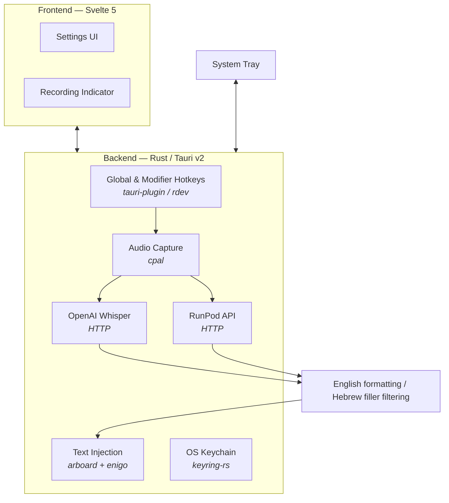

<p align="center">
  
</p>

<h1 align="center">AirType</h1>

<p align="center">
  Voice-to-text for your desktop — English &amp; Hebrew
</p>

<p align="center">
  <a href="#installation">Install</a> · <a href="#setup">Setup</a> · <a href="#usage">Usage</a> · <a href="#troubleshooting">Troubleshooting</a>
</p>

---

AirType is a lightweight desktop app that transcribes your voice and inserts the text at your cursor. Press a hotkey, speak, and the words appear wherever you're typing. Works system-wide across all applications.

## Features

- **Global hotkeys** — record from any application with a single keypress.
- **English and Hebrew** — dedicated hotkeys and endpoints configured for each language.
- **English dictation formatting** — opt-in spoken punctuation, automatic punctuation removal, and lowercase text. See [commands and examples](docs/english-dictation.md).
- **Customizable Cloud Endpoints** — dynamically route English to OpenAI or a Custom RunPod endpoint, while strictly routing Hebrew to the `ivrit-ai` model.
- **Floating indicator** — unobtrusive on-screen dot shows recording state.
- **System tray** — runs in the background with near-zero resource usage.
- **Auto-start** — optional launch on login.
- **Self-update** — checks GitHub releases on startup and installs signed updates in-app with one click.
- **Secure storage** — API keys are kept in the OS keychain, never in config files.

## Transcription Engines

AirType uses robust Cloud API endpoints to ensure the highest transcription quality. 

| Language | Default Endpoint | Alternative Endpoints | Mode |
|---|---|---|---|
| **Hebrew** | **RunPod** (configured ivrit-ai endpoint) | — | Batch, after recording stops |
| **English** | **Same as Hebrew (RunPod)** | **OpenAI** (whisper-1), **Custom RunPod** | Batch, after recording stops |

Latency depends on recording length, provider load, and RunPod worker cold starts.
Audio goes to the selected provider; AirType does not download or run local models.

### Recording modes

| Mode | Behavior |
|------|----------|
| **Hold** (default) | Hold the hotkey to record, release to stop |
| **Toggle** | Press once to start, press again to stop |

## Installation

### Quick install (recommended)

**Linux / macOS**
```bash
curl -fsSL https://raw.githubusercontent.com/MatanelP/AirType/main/scripts/install.sh | sh
```

**Windows (PowerShell)**
```powershell
irm https://raw.githubusercontent.com/MatanelP/AirType/main/scripts/install.ps1 | iex
```

The script auto-detects your OS and architecture, downloads the correct release asset, installs it (using `apt`/`dnf` on Linux, `/Applications` on macOS, MSI on Windows), and on macOS strips the quarantine attribute so the ad-hoc signed bundle launches without Gatekeeper blocking it.

Pin a specific version by exporting `AIRTYPE_VERSION=v1.0.1` before running.

### Manual download

Grab the asset for your OS from the [Releases page](https://github.com/MatanelP/AirType/releases/latest):

- **Linux** — `.AppImage` (chmod +x and run), `.deb`, or `.rpm`
- **Windows** — `_x64-setup.exe` (NSIS) or `_x64_en-US.msi`
- **macOS (Apple Silicon)** — `_aarch64.dmg`

#### macOS: bypass the "app is damaged" warning

The macOS build is ad-hoc signed but not notarized (Apple's notary service requires a paid Developer account). After dragging AirType to Applications, run this one-liner to remove the quarantine attribute:

```bash
xattr -cr /Applications/AirType.app
```

Then launch normally. You only need to do this once. The quick-install script does this for you automatically.

### Build from source

#### Prerequisites

**Linux (Ubuntu/Debian)**
```bash
sudo apt install -y \
    libgtk-3-dev libwebkit2gtk-4.1-dev libappindicator3-dev \
    librsvg2-dev patchelf libasound2-dev libssl-dev libxdo-dev \
    libdbus-1-dev pkg-config build-essential cmake
```

**macOS**
```bash
xcode-select --install
```

**Windows**
- [Visual Studio Build Tools](https://visualstudio.microsoft.com/visual-cpp-build-tools/)
- [CMake](https://cmake.org/download/)

#### Build

```bash
git clone https://github.com/MatanelP/AirType.git
cd AirType
npm install
npm run tauri build
```

For development with hot reload:
```bash
npm run tauri dev
```

## Setup

### Endpoint Configuration

1. **RunPod (Hebrew)**
   - Sign up at [runpod.io](https://runpod.io)
   - Deploy the ivrit-ai endpoint from the [RunPod console](https://www.runpod.io/console/hub/ivrit-ai/runpod-serverless)
   - Set Active Workers to 0 for scale-to-zero billing
   - Copy your API key and Endpoint ID into AirType Settings

2. **OpenAI (Alternative English Endpoint)**
   - If the RunPod `ivrit-ai` model outputs English dictations using Hebrew script, you can easily separate your English endpoint.
   - Create an API key at [platform.openai.com/api-keys](https://platform.openai.com/api-keys)
   - Change **English Endpoint** to **OpenAI** in Settings and paste your key.

## Usage

1. Launch AirType — it appears in your system tray
2. Place your cursor where you want text inserted
3. Press your hotkey (default: `Ctrl+Shift+E` for English, `Ctrl+Shift+H` for Hebrew)
4. Speak naturally
5. The transcribed text is inserted at your cursor

Use the **Test** buttons in the main window to verify your API configuration.

Under **Settings → English dictation**, enable any of the three formatting options
independently. All default to off, including when loading older settings. See
[English dictation formatting](docs/english-dictation.md) for commands and limitations.
Endpoint tests apply formatting too; they do not test microphone capture or insertion.
Punctuation removal cleans email sentence marks and paired wrappers while
preserving meaningful URL suffixes inside the value.

Hebrew filler filtering suppresses standalone `תודה` / `תודה רבה` only when a
nonempty capture is entirely finite digital silence, checked in short windows.
Any nonzero signal, however quiet or brief, is retained; empty or invalid capture
data is treated as uncertain and retained too. Discarded results do not replace
the last transcription, enter history, or insert text. Background noise can keep
hallucinated filler; preserving possible speech takes priority.

History stores up to 100 transcriptions locally, with copy/delete controls.
Dismissing the last-transcription card does not clear history. Settings includes
a Logs panel with refresh, copy, and export controls.

## Architecture



### Tech stack

| Layer | Technology |
|-------|------------|
| Framework | [Tauri v2](https://tauri.app/) |
| Backend | Rust |
| Frontend | [Svelte 5](https://svelte.dev/) |
| APIs | Standard JSON HTTP Requests (`reqwest`) |
| Modifier Hotkeys | [rdev](https://github.com/Narsil/rdev) |
| Audio | [cpal](https://github.com/RustAudio/cpal) |
| Text injection | [arboard](https://github.com/1Password/arboard) + [enigo](https://github.com/enigo-rs/enigo) |

## Troubleshooting

**Linux: Hotkeys not responding**
Wayland has limited global hotkey support. Run under X11 or XWayland.

**macOS: "AirType is damaged and can't be opened"**
The release builds are ad-hoc signed but not notarized. macOS may still block them after download. Clear the quarantine attribute:
```bash
xattr -cr /Applications/AirType.app
```
Then right-click the app and choose *Open*.

**macOS: Permission errors**
Go to System Settings → Privacy & Security and enable AirType under *Accessibility*, *Input Monitoring*, and *Microphone*. (Note: `rdev` requires Input Monitoring for single-modifier hotkeys).

**Cloud transcription not working**
Verify your keys with the built-in test buttons. For OpenAI, confirm that billing is active. For RunPod, check that your endpoint has at least one max worker configured.

## Updates

AirType updates itself using the [Tauri updater](https://tauri.app/plugin/updater/). On launch it checks
`https://github.com/MatanelP/AirType/releases/latest/download/latest.json`; if a newer signed version is
published, a banner appears in the main window with an **Install & Restart** button. You can also trigger a
check manually from **Settings → Updates → Check now**, or disable the startup check there.

Updates are cryptographically verified against the public key embedded in `tauri.conf.json` — an update that
isn't signed with the matching private key is rejected.

### Releasing (maintainers)

Updates only work if the release artifacts are **signed** and accompanied by a `latest.json` manifest. The CI
workflow (`.github/workflows/build.yml`) does both automatically on a `v*` tag, but it needs the signing
keypair provided as repository secrets:

| Secret | Value |
|---|---|
| `TAURI_SIGNING_PRIVATE_KEY` | Contents of the private key file generated by `npx tauri signer generate` |
| `TAURI_SIGNING_PRIVATE_KEY_PASSWORD` | The key's password (leave empty if generated without one) |

To cut a release:

For **1.5.0**, merge PRs **#2 and #4 before #3**. PR #3 contains the version bump
and automatic release workflow; merging it first tags a release without the later
PRs. Resolve review blockers and complete platform smoke tests before that merge.

1. Bump the version in `package.json`, `src-tauri/Cargo.toml`, and `src-tauri/tauri.conf.json`, and update `package-lock.json` and `src-tauri/Cargo.lock`.
2. Merge the version bump and app changes into `main`. The release workflow validates the versions,
   creates the matching `v<version>` tag at that commit, and explicitly dispatches the signed build workflow at the tag.
3. CI builds every platform, signs the updater artifacts (`.sig`), generates `latest.json`, and attaches
   everything to the GitHub release. Existing installs pick it up on their next launch.

An unchanged version whose tag points to an earlier commit is skipped; existing tags are never moved.
To recover a failed build or publish, rerun **Build & Release** or dispatch it with the existing version tag:
`gh workflow run build.yml --ref v<version>`. Rerunning **Release version merged to main** at the tagged
commit also dispatches that tag again. Manual `v*` tag pushes continue to work.

CI validates that all app and lockfile versions agree and that a release tag matches
that version before starting the platform builds. Publishing requires exactly one
signed updater package for each supported platform (Linux x86_64, macOS Apple Silicon,
and Windows x86_64). Missing packages, empty signatures, and duplicate targets fail
the release job. Run `node --test scripts/release.test.mjs scripts/plan-main-release.test.mjs`
to test release validation and planning locally.

These checks validate metadata and artifact selection; they do not run application
tests or prove microphone, provider, insertion, and updater behavior. See the
[release validation checklist](TODOs.md) and [agent guidance](AGENTS.md).

> **Keep the private key safe.** If it's lost, you can't sign updates and the pubkey in `tauri.conf.json`
> must be rotated (which breaks updates for already-installed clients until they reinstall).

## License

MIT
