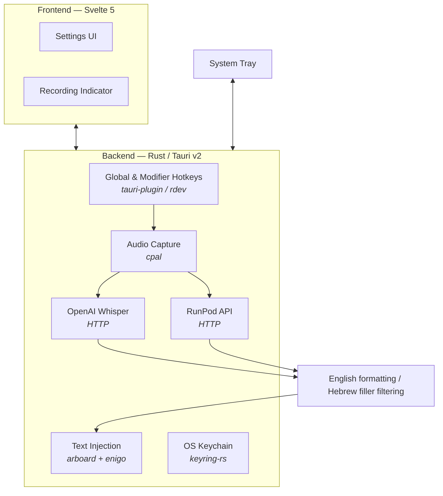

<p align="center">
  
</p>

<h1 align="center">AirType</h1>

<p align="center">
  Voice-to-text for your desktop — English &amp; Hebrew
</p>

<p align="center">
  <a href="#installation">Install</a> · <a href="#setup">Setup</a> · <a href="#usage">Usage</a> · <a href="#troubleshooting">Troubleshooting</a>
</p>

---

AirType is a lightweight desktop app that transcribes your voice and inserts the text at your cursor. Press a hotkey, speak, and the words appear wherever you're typing. Works system-wide across all applications.

## Features

- **Global hotkeys** — record from any application with a single keypress.
- **English and Hebrew** — dedicated hotkeys and endpoints configured for each language.
- **English dictation formatting** — opt-in spoken punctuation and automatic punctuation/capitalization cleanup. See [commands and examples](docs/english-dictation.md).
- **Customizable Cloud Endpoints** — dynamically route English to OpenAI or a Custom RunPod endpoint, while strictly routing Hebrew to the `ivrit-ai` model.
- **Floating indicator** — unobtrusive on-screen dot shows recording state.
- **System tray** — runs in the background with near-zero resource usage.
- **Auto-start** — optional launch on login.
- **Self-update** — checks GitHub releases on startup and installs signed updates in-app with one click.
- **Secure storage** — API keys are kept in the OS keychain, never in config files.

## Transcription Engines

AirType uses robust Cloud API endpoints to ensure the highest transcription quality. 

| Language | Default Endpoint | Alternative Endpoints | Mode |
|---|---|---|---|
| **Hebrew** | **RunPod** (configured ivrit-ai endpoint) | — | Batch, after recording stops |
| **English** | **Same as Hebrew (RunPod)** | **OpenAI** (whisper-1), **Custom RunPod** | Batch, after recording stops |

Latency depends on recording length, provider load, and RunPod worker cold starts.
Audio goes to the selected provider; AirType does not download or run local models.

### Recording modes

| Mode | Behavior |
|------|----------|
| **Hold** (default) | Hold the hotkey to record, release to stop |
| **Toggle** | Press once to start, press again to stop |

## Installation

### Quick install (recommended)

**Linux / macOS**
```bash
curl -fsSL https://raw.githubusercontent.com/MatanelP/AirType/main/scripts/install.sh | sh
```

**Windows (PowerShell)**
```powershell
irm https://raw.githubusercontent.com/MatanelP/AirType/main/scripts/install.ps1 | iex
```

The script auto-detects your OS and architecture, downloads the correct release asset, installs it (using `apt`/`dnf` on Linux, `/Applications` on macOS, MSI on Windows), and on macOS strips the quarantine attribute so the ad-hoc signed bundle launches without Gatekeeper blocking it.

During a progressive rollout, an unpinned installer uses the newest stable release
that contains its package, capped by the global latest version. If necessary it
checks the first 100 public releases. `AIRTYPE_VERSION` stays an exact pin and
never falls back; API, metadata, and download errors also do not trigger downgrade.
The Linux/macOS helper uses standard `awk` to read release metadata.

Pin a specific version by exporting `AIRTYPE_VERSION=v1.0.1` before running.

### Manual download

Grab the asset for your OS from the [Releases page](https://github.com/MatanelP/AirType/releases/latest):

- **Linux** — `.AppImage` (chmod +x and run), `.deb`, or `.rpm`
- **Windows** — `_x64-setup.exe` (NSIS) or `_x64_en-US.msi`
- **macOS (Apple Silicon)** — `_aarch64.dmg`

#### macOS: bypass the "app is damaged" warning

The macOS build is ad-hoc signed but not notarized (Apple's notary service requires a paid Developer account). After dragging AirType to Applications, run this one-liner to remove the quarantine attribute:

```bash
xattr -cr /Applications/AirType.app
```

Then launch normally. You only need to do this once. The quick-install script does this for you automatically.

### Build from source

#### Prerequisites

Use **Node.js 20 or newer**, npm, and (for desktop development) the stable
Rust toolchain (`cargo` and `rustc`). Native Windows users can run `npm ci`
directly; the setup helper requires Bash (for example, Git Bash).

**Linux (Ubuntu/Debian)**
```bash
sudo apt install -y \
    libgtk-3-dev libwebkit2gtk-4.1-dev libappindicator3-dev \
    librsvg2-dev patchelf libasound2-dev libssl-dev libxdo-dev \
    libdbus-1-dev libx11-dev libxi-dev libxtst-dev pkg-config build-essential cmake
```

**macOS**
```bash
xcode-select --install
```

**Windows**
- [Visual Studio Build Tools](https://visualstudio.microsoft.com/visual-cpp-build-tools/)
- [CMake](https://cmake.org/download/)

#### Build

```bash
git clone https://github.com/MatanelP/AirType.git
cd AirType
npm run setup
npm run tauri build
```

The setup helper checks prerequisites and runs `npm ci` using the committed
lockfile. It can be run from any directory with `bash /path/to/AirType/scripts/setup.sh`.
It does not install system packages, change security settings, download models,
or store API keys. Install the platform dependencies above separately.

Check prerequisites without installing anything:
```bash
npm run setup:check
```

Desktop development requires the `src-tauri` directory, including `Cargo.toml`
and `tauri.conf.json`. If your checkout does not contain it, restore the backend
from a complete source checkout before running desktop commands. To work on the
Svelte frontend independently:
```bash
npm run setup -- --frontend-only
npm run dev
```
The browser frontend alone does not provide desktop recording, hotkeys, secure
credential storage, or transcription commands.

For development with hot reload:
```bash
npm run tauri dev
```

For browser-only Settings layout and tooltip checks, start `npm run dev`, then
run `npm run test:settings-ui` in another terminal with Node.js 20+ and Chrome
installed. Set `AIRTYPE_CHROME_PATH` if Chrome is not at `/usr/bin/google-chrome`;
`AIRTYPE_UI_URL` can select another local development-server URL. This checks
350px/420px widths at 400px/800px heights, full switch size, and tooltip
pointer/keyboard/touch behavior, including keyboard scrolling of clipped help.
It does not test native recording or text insertion.

## Setup

### Endpoint Configuration

1. **RunPod (Hebrew)**
   - Sign up at [runpod.io](https://runpod.io)
   - Deploy the ivrit-ai endpoint from the [RunPod console](https://www.runpod.io/console/hub/ivrit-ai/runpod-serverless)
   - Set Active Workers to 0 for scale-to-zero billing
   - Copy your API key and Endpoint ID into AirType Settings

2. **OpenAI (Alternative English Endpoint)**
   - If the RunPod `ivrit-ai` model outputs English dictations using Hebrew script, you can easily separate your English endpoint.
   - Create an API key at [platform.openai.com/api-keys](https://platform.openai.com/api-keys)
   - Change **English Endpoint** to **OpenAI** in Settings and paste your key.

## Usage

1. Launch AirType — it appears in your system tray
2. Place your cursor where you want text inserted
3. Press your hotkey (default: `Ctrl+Shift+E` for English, `Ctrl+Shift+H` for Hebrew)
4. Speak naturally
5. The transcribed text is inserted at your cursor

Use the **Test** buttons in the main window to verify your API configuration.

Under **Settings → English dictation**, enable either of the two formatting options
independently. All default to off, including when loading older settings. See
[English dictation formatting](docs/english-dictation.md) for commands and limitations.
When spoken punctuation is enabled, each command writes its mark: saying
“question mark” three times writes `???`, even with punctuation removal enabled.
“Dot” means a period; “dot dot dot” writes `...`. Hover or focus the help button
beside Spoken punctuation for the command guide.
Removal conservatively cleans sentence capitals: `Hi. How are you?` becomes
`Hi how are you`, while `Hi, I love you.` becomes `Hi I love you`.
Endpoint tests apply formatting too; they do not test microphone capture or insertion.
Punctuation removal cleans email sentence marks and paired wrappers while
preserving meaningful URL suffixes inside the value.

Hebrew filler filtering suppresses standalone `תודה` / `תודה רבה` only when a
nonempty capture is entirely finite digital silence, checked in short windows.
Any nonzero signal, however quiet or brief, is retained; empty or invalid capture
data is treated as uncertain and retained too. Discarded results do not replace
the last transcription, enter history, or insert text. Background noise can keep
hallucinated filler; preserving possible speech takes priority.

History stores up to 100 transcriptions locally, with copy/delete controls.
Dismissing the last-transcription card does not clear history. Settings includes
a Logs panel with refresh, copy, and export controls.

## Architecture



### Tech stack

| Layer | Technology |
|-------|------------|
| Framework | [Tauri v2](https://tauri.app/) |
| Backend | Rust |
| Frontend | [Svelte 5](https://svelte.dev/) |
| APIs | Standard JSON HTTP Requests (`reqwest`) |
| Modifier Hotkeys | [rdev](https://github.com/Narsil/rdev) |
| Audio | [cpal](https://github.com/RustAudio/cpal) |
| Text injection | [arboard](https://github.com/1Password/arboard) + [enigo](https://github.com/enigo-rs/enigo) |

## Troubleshooting

**Linux: Hotkeys not responding**
Wayland has limited global hotkey support. Run under X11 or XWayland.

**macOS: "AirType is damaged and can't be opened"**
The release builds are ad-hoc signed but not notarized. macOS may still block them after download. Clear the quarantine attribute:
```bash
xattr -cr /Applications/AirType.app
```
Then right-click the app and choose *Open*.

**macOS: Permission errors**
Go to System Settings → Privacy & Security and enable AirType under *Accessibility*, *Input Monitoring*, and *Microphone*. (Note: `rdev` requires Input Monitoring for single-modifier hotkeys).

**Cloud transcription not working**
Verify your keys with the built-in test buttons. For OpenAI, confirm that billing is active. For RunPod, check that your endpoint has at least one max worker configured.

## Updates

AirType updates itself using the [Tauri updater](https://tauri.app/plugin/updater/). On launch it checks
`https://github.com/MatanelP/AirType/releases/latest/download/latest.json`; if a newer signed version is
published, a banner appears in the main window with an **Install & Restart** button. You can also trigger a
check manually from **Settings → Updates → Check now**, or disable the startup check there.

Updates are cryptographically verified against the public key embedded in `tauri.conf.json` — an update that
isn't signed with the matching private key is rejected.

### Releasing (maintainers)

Updates only work if the release artifacts are **signed** and accompanied by a `latest.json` manifest. The CI
workflow (`.github/workflows/build.yml`) does both automatically on a `v*` tag, but it needs the signing
keypair provided as repository secrets:

| Secret | Value |
|---|---|
| `TAURI_SIGNING_PRIVATE_KEY` | Contents of the private key file generated by `npx tauri signer generate` |
| `TAURI_SIGNING_PRIVATE_KEY_PASSWORD` | The key's password (leave empty if generated without one) |

To cut a release:

Release **1.5.0** included PRs #2, #4, and #3 merged in that order. For future
releases, merge all intended changes before the version bump that triggers
publication. Resolve review blockers and complete platform smoke tests first.

1. Bump the version in `package.json`, `src-tauri/Cargo.toml`, and `src-tauri/tauri.conf.json`, and update `package-lock.json` and `src-tauri/Cargo.lock`.
2. Merge the version bump and app changes into `main`. The release workflow validates the versions,
   creates the matching `v<version>` tag at that commit, and explicitly dispatches the signed build workflow at the tag.
3. CI builds all three platforms in parallel. Each successful build publishes its signed packages
   immediately to the **same** `v<version>` release and extends its shared `latest.json`.
   Existing installs on that platform can discover the update without waiting for the other builds.
   The release is complete when all three publishers succeed; first publication alone does not mean completion.

An unchanged version whose tag points to an earlier commit is skipped; existing tags are never moved.
For versions using progressive publishing, retry the failed/cancelled **publisher job** from its original
run, reusing that run's completed platform artifact. The job rerun API is
`gh api --method POST repos/MatanelP/AirType/actions/jobs/<publisher-job-id>/rerun`.
If a build failed before uploading its artifact, rerun that failed build and its dependent publisher.
Do not rebuild already-published packages merely to retry publication: regenerated bytes can differ.
An identical existing package is reused; a conflicting package requires a new version.
Recover a cancelled or full-queue publisher the same way while its original artifact is retained.
After artifact expiry, cut a new version rather than replace published packages.

Historical tags retain their old workflows. Do **not** rerun/dispatch old all-at-once release workflows
as a progressive recovery path: they lack the shared publisher lock and latest-version guard.
Never move a published tag. Manual `v*` tag pushes continue to work for new versions.

CI validates that all app and lockfile versions agree and that a release tag matches
that version before starting the platform builds. Each publisher requires its complete installer set
and exactly one signed updater package for its supported platform (Linux x86_64, macOS Apple Silicon,
or Windows x86_64). It uploads packages before advertising them. A repository-wide
[queued concurrency group](https://docs.github.com/en/actions/how-tos/write-workflows/choose-when-workflows-run/control-workflow-concurrency)
serializes publication across platforms, versions, and retries; builds remain parallel.
The manifest is reconstructed from all completed signed package sets already attached to that release,
so later publishers preserve earlier targets and can recover a missing manifest.
Numeric version comparison prevents an older release's retry from replacing a newer global latest.
Release notes and the manifest publication date stay fixed as platforms arrive.

Progressive publication requires **mutable GitHub releases**. Maintainers must verify repository/owner
immutability policy before releasing; the workflow token cannot read that administrative setting.
The publisher rejects existing immutable or unknown release metadata, and checks again after publishing
the initial draft, before promotion. If protection is enabled, stop and choose a different release design;
do not disable it or add an administrative credential to this workflow. The initial draft contains packages
and a valid manifest before it becomes public. Packages/signatures are never overwritten.

Until a platform arrives, its updater target is omitted. Older installed clients on that platform may
temporarily report a missing-target update-check error; they are never offered an older binary labeled
as the new version. A failed platform can leave a release partial until recovered. Replacing GitHub's
`latest.json` asset is non-atomic and can briefly return 404; a failed replacement requires a publisher
retry, which rebuilds it from the unchanged signed packages. The updater URL and signing public key stay unchanged.

Run `node --test scripts/release.test.mjs scripts/plan-main-release.test.mjs scripts/publish-platform-release.test.mjs scripts/installers.test.mjs`
to test release validation, planning, progressive arrival orders, failure/retry behavior, and mocked installers locally.
Run `pwsh -NoProfile -File scripts/installers-windows.test.ps1` for the Windows resolver;
the Node suite runs it automatically when PowerShell is available.

These checks validate metadata and artifact selection; they do not run application
tests or prove microphone, provider, insertion, and updater behavior. See the
[release validation checklist](TODOs.md) and [agent guidance](AGENTS.md).

> **Keep the private key safe.** If it's lost, you can't sign updates and the pubkey in `tauri.conf.json`
> must be rotated (which breaks updates for already-installed clients until they reinstall).

## License

MIT
